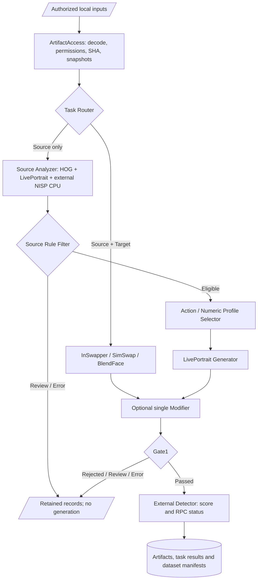

# DeepFake Red Team Attacker

**A traceable, source-aware dual-branch pipeline for authorized Deepfake research.**

<p align="center">
  <a href="https://deepfake-redteam-showcase.pages.dev/"></a>
  <a href="docs/assets/redteam_demo.mp4"></a>
  <a href="https://github.com/KJHkong/deepfake-redteam-showcase"></a>
  <br>
  <a href="#quick-start"></a>
  <a href="docs/runtime.md"></a>
</p>

面向授权红队评估与合成数据生产的研究工程。项目将 **Source + Target 换脸** 与 **Source-only 状态感知编辑** 接入同一套输入校验、Artifact血缘、可选图像处理、Gate1和检测评估流程。

当前发布的是 **v0.2 框架源码整理版**。CPU协议演示和契约测试可独立运行；真实生成还需要另行配置第三方代码、权重、模型环境和授权后端。公开网站展示的是 **Precomputed Demo**，不会在线运行模型或接收图片上传。

**[40秒演示视频（1080p，含BGM）](docs/assets/redteam_demo.mp4)**：展示双链路架构、换脸预设、面部编辑、Modifier和历史检测结果。画面来自已公开网站及预计算样本，不表示实时模型推理；音频来源见[第三方说明](THIRD_PARTY_NOTICES.md#demo-video-audio)。

## What It Does

- **Swapping**：Source提供身份，Target提供画布；主链路使用InSwapper、SimSwap、BlendFace。
- **Auto Editing**：分析Source人脸数量、姿态与眼口观测，以冻结规则选择LivePortrait动作和强度。
- **Controlled execution**：模型运行在独立Worker；输入字节快照、SHA256、超时和失败记录贯穿任务。
- **Optional Modifier**：JPEG、模糊、颜色、噪声、缩放、锐化、裁剪补边、像素化共8种独立算子。
- **Evaluation and traceability**：Gate1检查图像有效性；外部Detector保留连续分数、阈值和错误；任务结果保存输入输出与血缘。

编排和Source筛选采用确定性规则。LLM辅助建议曾独立探索，不是这里默认运行的决策器；不包含自主优化、训练或分数反馈参数搜索。

## Architecture



Generated-image Analyzer/Post-check、Refiner、Retrieval、MMD和LLM不在最终双链路默认路径。Gate1不是Deepfake检测器；缺失的Detector结果保持未评分，不当作Real预测。

## Quick Start

要求 **Python 3.11**。在仓库根目录执行；以下只安装轻量框架依赖，不下载模型或占用GPU。

```bash
git clone https://github.com/KJHkong/DeepFake-Red-Team-Attacker.git
cd DeepFake-Red-Team-Attacker
python3.11 -m venv .venv
source .venv/bin/activate
python -m pip install -e '.[test]'

# 验证CPU导入、冻结Profile和配置；不是模型/服务健康检查。
python -m attacker_cli check

# 只校验示例任务的角色与格式；示例图片未随包分发，不执行推理。
python -m attacker_cli batch --manifest examples/tasks.json

# 运行8种明确标记mock=true的几何图协议演示，包括失败/拒绝路径。
# 这些输出不能用来评估真实生成质量或攻击率。
python -m scripts.demo --runs-root outputs/protocol_demo --all

python -m pytest -q
```

采用源码检出＋editable安装，并从仓库根运行，保留`configs/`；当前没有发布PyPI包，也没有承诺独立wheel的数据文件布局。真实模型依赖不进入上述`.venv`。

## Real Generation / Batch

真实运行仍调用`DualBranchPipeline.prepare → plan_batch → execute`，没有第二套Generator循环。将已授权图片放入本地受控输入目录，按[examples/tasks.json](examples/tasks.json)填写任务：

```json
{
  "tasks": [
    {"task_id": "swap_01", "inputs": [
      {"role": "source", "path": "input_samples/source.png", "display_allowed": false},
      {"role": "target", "path": "input_samples/target.png", "display_allowed": false}
    ]},
    {"task_id": "edit_01", "inputs": [
      {"role": "source", "path": "input_samples/edit_source.png", "display_allowed": false}
    ]}
  ]
}
```

Source-only无需用户Prompt。动作由观测和冻结数值配置决定；英文描述是语义元数据，不是LivePortrait消费的自然语言。

真实执行前先按[运行依赖说明](docs/runtime.md)完成模型Smoke及本地后端绑定。下列命令是**部署完成后的入口**，默认公开包中缺失私有后端时会明确失败，不回退Mock：

```bash
# 仅本地维护人提供、验证部署；不把deployment_local.py提交Git。
# 它向examples/runtime_factory.py注入真实依赖与服务端InputPolicy。
export ATTACKER_WORKER_CONFIG="$PWD/configs/generator_workers.local.json"
export ATTACKER_TOOL_CATALOG="$PWD/configs/generator_catalog.local.json"
python -m attacker_cli batch --manifest examples/tasks.json \
  --factory examples.runtime_factory:create_pipeline \
  --output outputs/my_first_batch --execute
```

必须使用新的输出目录；同一次调用不替换输入、不按Detector分数重试。入口不自动恢复失败批次，不改配额补齐产量。长任务可由维护人在既有tmux会话中运行；资源准入由部署端`gpu_guard`控制，不抢占其他进程。

## Core Layout

```text
.
├── attacker_cli.py          # CPU检查、任务格式验证和薄Batch入口
├── core/                    # 双链路、输入快照、Artifact与Gate1
├── modules/
│   ├── generator/           # Registry、隔离Adapter及Worker
│   ├── source_state/        # 状态观测、五动作规则与调度
│   ├── modifier/            # 8种图像算子
│   ├── examiner/            # 单图有效性及CPU人脸检查
│   ├── evaluator/           # CPU协议演示；真实Detector由部署端注入
│   └── visualization/       # 核验图与元数据关联
├── shared/                  # 统一Schema与依赖接口
├── configs/                 # 冻结动作、关闭的筛选示例及服务示例
├── examples/                # 不含图片的任务与部署绑定示例
├── scripts/demo.py          # 明确标记Mock的CPU协议演示
├── tests/                   # 无GPU/私有服务的契约验证
└── docs/runtime.md          # 模型环境、服务边界与接入说明
```

为保留可追溯配置，部分内部模块文件名保留原实验版本后缀；它们不代表执行时必须处于某个开发Day。公开目录没有原实验Git历史。

## Historical Validation

以下为此前真实执行的受控实验，**不是Quick Start重新生成的成绩，也不是独立业务Benchmark**。原图、日志和逐图分数不随源码分发。

| 批次 | 任务数 | 实际生成 | Gate1通过 |
|---|---:|---:|---:|
| v0.2 Swapping Scale | 80 | 79 | 75 |
| v0.2 Editing Scale | 80 | 80 | 73 |
| 合计 | 160 | 159 | 148 |

另外，MobileFaceSwap和UniFace各在同一套冻结50组Source/Target上完成独立评估，分别生成50/48张，Gate1通过49/48张。它们的Adapter/Worker源码保留，但未自动并入主链路三工具调度；UniFace的整图回贴是显式Adapter扩展，不能宣称为官方原生能力。

Detector的Real/Fake仅是给定实验阈值下的预测，**不等于生成质量、身份保持或已经确认的攻击成功**。0.5不是已确认的生产阈值。Source规则是受控单脸场景的Pilot启发式，HOG与LivePortrait可能漏检或计数不一致；单脸OR规则不应直接用于开放世界输入。

## Services, Models and Scope

| 组件 | 公开内容 | 需要另行准备 |
|---|---|---|
| 轻量编排 | 核心源码、Schema、配置、CPU演示 | Python3.11及声明依赖 |
| Generator | 我们的集成Adapter和Worker | 官方Repo、许可允许的权重、各自独立环境 |
| Gate1 | 有效性检查、dlib HOG进程接口 | 独立CPU dlib环境及实际版本配置 |
| Source Analyzer | LP观测、规则、NISP客户端边界 | LP资产；NISP授权服务及显式注入的IDL/stubs |
| Detector | `DetectorConfig/DetectorResult/DetectorClient`契约 | 本地真实客户端与授权服务；可按部署采用Docker＋Thrift |
| Web Demo | 已发布静态案例网站入口及40秒演示视频 | 网站源码在独立Showcase仓库 |

内部Detector Docker、NISP镜像、服务端源码、IDL/stubs、内部Registry地址、业务原图、模型权重和凭据不公开。源码不会自动pull/build/start这些服务；未配置的能力必须显示不可用。

## References / Permissions

[InsightFace InSwapper](https://github.com/deepinsight/insightface/tree/master/examples/in_swapper) · [SimSwap](https://github.com/neuralchen/SimSwap) · [BlendFace](https://github.com/mapooon/BlendFace) · [LivePortrait](https://github.com/KlingAIResearch/LivePortrait) · [MobileFaceSwap](https://github.com/Seanseattle/MobileFaceSwap) · [UniFace](https://github.com/xc-csc101/UniFace)

源码集成不授予第三方模型/权重的再分发或商业许可。参见[第三方来源说明](THIRD_PARTY_NOTICES.md)。项目整体发布许可待负责人确定，当前未擅自附加MIT/Apache等许可证。

仅在授权、知情和可追溯的研究场景使用。后续重点为模型部署可移植性、规则校准和公开演示材料完善；不将未验证功能写作已完成。
